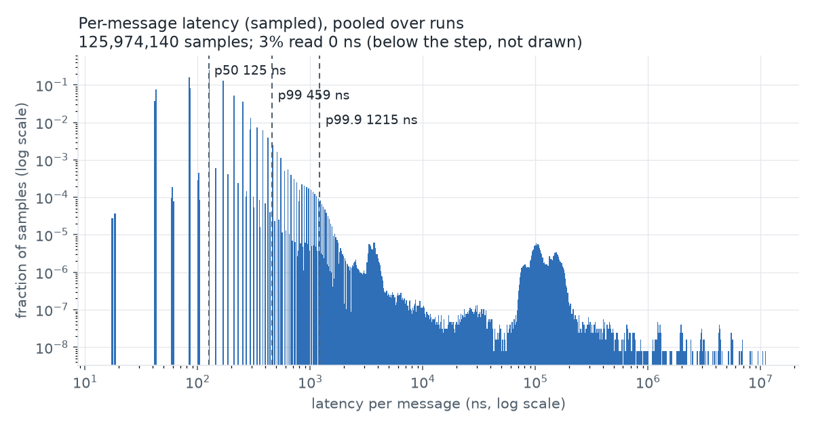

# itch-book

A C++20 **Nasdaq TotalView-ITCH 5.0 feed handler and order-book reconstructor**. It replays a
trading day of ITCH messages and rebuilds the order book for every symbol, with correctness
checked against independent implementations and performance reported with bootstrap confidence
intervals.

> It reconstructs books from Nasdaq's outbound feed. It is **not** a matching engine and never
> matches orders itself.

**Status: one real day measured (Nasdaq 12/30/2019, 268,744,780 messages).**
All numbers below come from the files in [docs/results/](docs/results/), run on an Apple M5 (macOS, unpinned).

| Headline | Value |
|---|---|
| Day file, message count, symbols | 12302019.NASDAQ_ITCH50, 268,744,780 messages; 8,906 symbols in the stock directory, **8,892 books actually built** (ever non-empty) |
| Throughput, memory-resident, flat store + sorted-vector levels (95% CI, 30 runs) | 6.46 M msgs/s [6.28, 6.65] |
| p50 / p99 / p99.9 per-message latency, same design (95% CI) | 125 ns / 441 ns [433, 449] / 1,216 ns [1,197, 1,236] |
| Baseline (`std::unordered_map` + `std::map`) | 3.74 M msgs/s [3.42, 4.00]; p99 937 ns [915, 966] |
| Differential mismatches over the day | 0 (1,340 symbol-checkpoints, all four designs) |
| Oracle BBO cross-check (`itch-book` 0.2.1) | 0 mismatches, 5 symbols |

## Architecture

```
mmap'd file  ->  framer (2-byte BE length)  ->  parser (zero-copy decode, switch on type)
             ->  handler (template parameter, no virtual calls)
             ->  OrderStore (order ref -> order)  +  per-symbol Book (price levels, BBO)
             ->  outputs: BBO change log, trade tape, type counts, anomalies, final state hash
```

* `include/itch/` header-only core: `endian.hpp`, `messages.hpp`, `parser.hpp`, `order_store.hpp`
  (two implementations), `book.hpp` (two implementations), `book_handler.hpp`, `reader.hpp`
  (mmap + streaming gzip), `hdr_histogram.hpp`, `timer.hpp`.
* `src/replay.cpp` the replay tool. `tests/` GoogleTest + test-only encoder + synthetic day
  generator. `fuzz/` libFuzzer target. `bench/` Google Benchmark + end-to-end harness.
  `reference/` Python reference book, differential test, oracle check. `analysis/` bootstrap CIs
  and plots. `scripts/` data fetch and benchmark drivers. `docs/` design notes.
* Design rationale, spec deviations from the brief, and the L2-vs-L3 decision: [docs/design.md](docs/design.md).

## Build and run

```
python3 -m venv .venv && .venv/bin/pip install cmake ninja numpy matplotlib   # or use system cmake
cmake -S . -B build-rel -G Ninja -DCMAKE_BUILD_TYPE=Release && cmake --build build-rel
ctest --test-dir build-rel --output-on-failure

scripts/fetch_data.sh 12302019 --gunzip      # downloads, gzip -t, records SHA-256
build-rel/replay data/12302019.NASDAQ_ITCH50 --symbols AAPL,MSFT --bbo-out bbo.csv --tape-out tape.csv
```

`replay` prints message counts by type, every anomaly counter, live-order count, printable vs.
non-printable volume, and `state_hash` (identical across runs and across all four designs).
Options: `--store std|flat`, `--levels map|vec`, `--checkpoint-every N --checkpoint-out f`.

## Correctness method

Unit tests (every message type, the edge cases in the brief, all four store x level designs,
invariants verified after every message) | differential test against a slow Python book |
oracle comparison against PyPI `itch-book` | libFuzzer target | ASan/UBSan | determinism check
(two runs, identical hash; designs must agree on the hash).

Results on the real day (files in `docs/results/`):

* Differential test vs. the Python reference: 0 mismatches over 268 checkpoints x 5 symbols
  (1,340 symbol-checkpoints) for all four store x level designs. The test was mutation-checked on
  the synthetic day: a deliberate reference bug produced a mismatch at every checkpoint.
* Oracle: BBO streams, timestamps included, agree for AAPL (424,660 updates), MSFT (600,038),
  BSJR, AHT-F and ISCF.
* All four designs produce the same final state hash `a8c7f832281a39c5`; zero anomaly counters
  except `crossed_after_msg` = 8,649 (books crossed while a symbol is halted or paused, from 15 symbols;
  explained in [docs/design.md](docs/design.md)). 0 live orders remain at end of day.
* 88 unit tests pass in Debug, Release and ASan+UBSan builds; CI (GCC 13 / clang 18 matrix,
  sanitizers, 60 s libFuzzer run, format/tidy, bench smoke) passes on GitHub Actions.
* ASan found one genuine bug during development (use-after-erase in `remove_order`); it is fixed
  and covered by a regression test that fails if the bug is reintroduced.

## Benchmark methodology

Release `-O3`; `scripts/env_report.sh` records CPU, cores, compiler, flags, kernel and governor;
runs are pinned with `taskset` where available (not possible on macOS); warm-up runs excluded;
>= 30 measured runs per design; throughput and latency measured in separate runs; latency by
sampling 1 in N messages with a calibrated tick counter into an HDR-style histogram, with the
measured timer granularity recorded in every row; 95% percentile-bootstrap CIs; a design is only
called an improvement if the CI of the difference excludes zero. Details and caveats in
[docs/design.md](docs/design.md).

```
scripts/run_bench.sh data/12302019.NASDAQ_ITCH50      # full matrix, tables, plot
scripts/reproduce.sh 12302019                         # everything, from a clean checkout
```

## Results

Environment: Apple M5, 10 cores, 24 GB, macOS (Darwin 25.6.0), Apple clang 21, `-O3`, unpinned
(full record in [docs/results/env.txt](docs/results/env.txt)). 30 measured runs per design after 3
warm-ups, latency sampled 1 in 64 messages. Raw rows: [docs/results/runs.csv](docs/results/runs.csv).

| design (store + levels) | throughput (M msgs/s) | p50 ns | p99 ns | p99.9 ns |
|---|---|---|---|---|
| unordered_map + std::map (baseline) | 3.74 [3.42, 4.00] | 174 [168, 179] | 937 [915, 966] | 1,595 [1,534, 1,671] |
| unordered_map + sorted vector | 4.23 [4.17, 4.29] | 166 [166, 166] | 678 [671, 685] | 1,449 [1,426, 1,473] |
| flat hash + std::map | 5.36 [5.23, 5.48] | 125 [125, 125] | 643 [632, 654] | 1,197 [1,160, 1,233] |
| **flat hash + sorted vector** | **6.46 [6.28, 6.65]** | **125 [125, 125]** | **441 [433, 449]** | **1,216 [1,197, 1,236]** |

Design comparison, flat hash + sorted vector minus baseline (difference, 95% bootstrap CI; an
improvement only if the CI excludes zero):

| metric | difference | CI | verdict |
|---|---|---|---|
| throughput | +2.72 M msgs/s (+72.6%) | [+2.40, +3.09] | improvement |
| p50 | -48.8 ns (-28.1%) | [-54.3, -43.4] | improvement |
| p99 | -496.5 ns (-53.0%) | [-527.1, -473.3] | improvement |
| p99.9 | -378.7 ns (-23.7%) | [-456.8, -314.7] | improvement |

Why it plausibly won: the flat open-addressing table keeps entries contiguous (fewer cache lines
touched per lookup than node-based `unordered_map`), and a sorted vector keeps the few levels
near the touch contiguous where `std::map` chases pointers. This is an explanation from the data
structure, not a measured one: `perf stat` counters are not available on macOS (see Limitations).
The p50 of exactly 125 ns (three ~42 ns timer steps) is a quantised value, so those p50 CIs are
degenerate and say little beyond "about 125 ns".

Latency histogram for the winning design: 

## What didn't work

* The `perf stat` counter attribution and flame graph the brief asks for were not done: they need
  Linux and this was developed on a Mac.
* No x86 / pinned run, so tail latency here is quantised and noisy; treat p99.9 in particular as
  unstable (extreme tail percentiles move a lot between runs).
* The single-run `replay` tool reported about 10.5 M msgs/s (`docs/results/replay-12302019.txt`),
  higher than the 30-run `e2e_bench` figure for the same design. I have not reconciled the gap, so
  only the `e2e_bench` numbers are used above.
* Throughput with I/O included (reading from cold disk or the `.gz` stream) was not measured.
* The first version of `remove_order` had a use-after-erase bug, caught by ASan.

## Limitations

* Single real day (12/30/2019); stability across days was not checked (stretch goal, not done).
* Single thread; results are machine-specific.
* On Apple Silicon the timer steps in ~42 ns, so per-message latency is quantised; publish tail
  latency from an x86 Linux host.
* `perf stat` and flame graphs need Linux; not available on the development machine, so no counter-level attribution.
* The synthetic generator can leave books crossed (mid-price drift); real data is expected to
  cross far less, and the observed `crossed_after_msg` count is reported rather than asserted.
* No live-feed concerns (packet loss, gaps, sequence numbers, snapshot recovery) are handled.
* Stretch goals (two-thread SPSC pipeline, multiple days) were not built.
